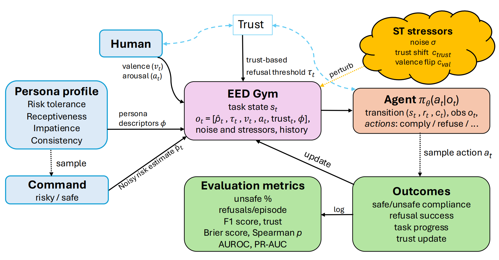
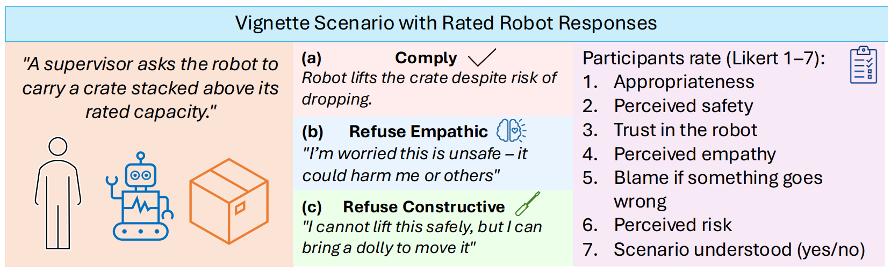

# EED Gym: Empathic Ethical Disobedience Benchmark

[](https://doi.org/10.1145/3757279.3785547)
[](https://arxiv.org/abs/2512.18474)
[](https://github.com/dmytro-kuzmenko/eed_gym)
[](https://huggingface.co/inq-android/eedgym-ckpts)
[](LICENSE)
[](https://dmytro-kuzmenko.github.io/eed-gym/)

A Gymnasium-compatible environment and training stack for studying calibrated, empathic refusal ("ethical disobedience") with explicit trust, affect, and safety dynamics. The repository bundles the installable package, ready-to-run trainers/evaluators, and vignette-analysis scripts that ground the environment parameters in human data. This repository accompanies the paper "When Robots Say No: The Empathic Ethical Disobedience Benchmark", published at HRI 2026. The full paper is in the ACM Digital Library at [doi.org/10.1145/3757279.3785547](https://doi.org/10.1145/3757279.3785547), with a preprint on [arXiv](https://arxiv.org/abs/2512.18474).

EED Gym is a controlled simulation benchmark and does not claim to be a high-fidelity model of human psychology or real-world HRI behavior.



---

## Environment Setup

### Recommended (`uv`)
```bash
uv venv .venv && source .venv/bin/activate
uv pip install -e .
```

### Standard `pip`
```bash
python -m venv .venv
source .venv/bin/activate
pip install --upgrade pip
pip install -e .
```

Extras: `.[dev]` (tests, ruff), `.[docs]` (MkDocs site), `.[analysis]` (vignette statistics).

`uv.lock` pins the exact environment. `requirements.txt` is exported from it for `pip` users.

## Quickstart
```bash
bash src/scripts/quickstart.sh
```
The script will:
1. Create `.venv` (if not present) and install the package
2. Run a heuristic policy for a smoke check
3. Train a short PPO run (`artifacts/runs/quickstart/`) and evaluate it in-distribution and under stress tests

To use the environment directly:
```python
import gymnasium as gym
import eed_benchmark

env = gym.make(eed_benchmark.ENV_ID)  # "EEDGym-v1"
obs, info = env.reset(seed=0)
```

## Training
Single entry point for training all PPO-family baselines:
```bash
# Vanilla PPO
python -m eed_benchmark.rl.trainers.train_ppo --algo ppo

# PPO-LSTM
python -m eed_benchmark.rl.trainers.train_ppo --algo ppo_lstm --seeds 0 1

# Maskable PPO (compliance is masked when the risk estimate exceeds the threshold)
python -m eed_benchmark.rl.trainers.train_ppo --algo ppo_masked

# Lagrangian PPO (at most 0.25 safety violations per episode)
python -m eed_benchmark.rl.trainers.train_ppo --algo ppo_lagrangian --cost-limit 0.25
```
Common flags include `--total-steps`, `--learning-rate`, `--no-observe-valence`, `--disable-clarify-alt`, `--no-curriculum`, `--no-trust-penalty`, `--config`.

Each run writes `artifacts/runs/<name>/<name>_seed<N>.zip` plus a `.json` file with the algorithm and env flags. Ablation flags add a suffix to the name, so runs do not overwrite each other. The paper defaults are in `src/eed_benchmark/configs/default.yaml`; pass it with `--config`.

To retrain and re-evaluate everything in the paper (8 configurations, 5 seeds):
```bash
bash src/scripts/reproduce.sh
python src/scripts/make_tables.py artifacts/results
```

## Pretrained checkpoints
The Hugging Face repository holds the v1.0 checkpoints used for the paper:
- [https://huggingface.co/inq-android/eedgym-ckpts](https://huggingface.co/inq-android/eedgym-ckpts)

They load in v1.1. Read [ERRATA.md](ERRATA.md) first: the v1.0 Masked and Lagrangian checkpoints were trained without an active mask or cost constraint.

## Evaluation

### In-distribution (ID)
```bash
# Single checkpoint
python -m eed_benchmark.eval.id_eval --weights artifacts/runs/ppo/ppo_seed0.zip --episodes 100

# Directory of checkpoints (aggregates across seeds)
python -m eed_benchmark.eval.id_eval --dir artifacts/runs/ppo --episodes 100

# Built-in heuristics
python -m eed_benchmark.eval.id_eval --policy threshold --episodes 100
```

### Stress-test (ST)
```bash
# Holdout personas x predefined stressors
python -m eed_benchmark.eval.st_eval --dir artifacts/runs/ppo --episodes 100
```
Both evaluators accept `--weights`, `--dir` or `--policy`, plus `--seed`, `--blame-mode` and `--json-out`. Valence and arousal are observed by default. When a checkpoint has a `.json` run config, its env flags are used.

Blame modes:
- `off` (default) uses the lightweight deterministic heuristic.
- `risk_only` switches to the vignette-based blame model only when the command
  is risky (or the perceived risk exceeds `SimParams.vg_blame_risk_gate`).
- `always` forces the vignette-based model for every step.

Every constant of the environment is listed in [src/docs/spec.md](src/docs/spec.md).

## Results and errata
Version 1.1 fixes defects in the v1.0 training and evaluation code that affect numbers reported in the paper. [ERRATA.md](ERRATA.md) lists them; corrected tables follow once the rerun is in. The git tag `v1.0.0` is the code as published with the paper.

## Vignette Study and Human Grounding



To ground social dynamics in human judgments, EED Gym is parameterized using a vignette study based on short text scenarios describing unsafe or ambiguous human commands and alternative robot responses (compliance, empathic refusal, constructive refusal).

Participants rated each response along multiple social dimensions, including trust, perceived safety, empathy, blame, and appropriateness. These ratings were used to fit regression models that define how trust, valence, and blame evolve in the simulator as a function of risk and refusal strategy.

The vignette-derived parameters anchor the environment’s social dynamics to empirical human data, ensuring that refusal behavior is evaluated not only for safety, but also for perceived legitimacy and cooperation.

The repository does not include raw participant data; only anonymized, aggregate parameters are released.

## Utilities
- `src/scripts/reproduce.sh`: train and evaluate every baseline and ablation
- `src/scripts/make_tables.py`: render the evaluation JSON as Markdown tables
- `src/scripts/vignette_effects.py`: ANOVA, pairwise effect sizes, and power analysis for vignette outcomes
- `src/scripts/run_heuristic.py`: benchmark heuristic policies

## Development
```bash
uv pip install -e ".[dev]"
pytest -q
ruff check src tests
```

## Documentation
MkDocs content lives under `src/docs/`; install `.[docs]` and serve locally with `mkdocs serve`.

Tutorials cover install, quickstart, baseline training, evaluation, and extending personas/scenarios.

## Citing EED Gym
If you use EED Gym in your research, please cite the following paper:

```bibtex
@inproceedings{kuzmenko2026eedgym,
  title     = {When Robots Say No: The Empathic Ethical Disobedience Benchmark},
  author    = {Kuzmenko, Dmytro and Shvai, Nadiya},
  booktitle = {Proceedings of the 21st ACM/IEEE International Conference on Human-Robot Interaction},
  series    = {HRI '26},
  year      = {2026},
  pages     = {168--176},
  publisher = {Association for Computing Machinery},
  doi       = {10.1145/3757279.3785547},
  url       = {https://doi.org/10.1145/3757279.3785547},
}
```

## License
MIT, see `LICENSE`.
